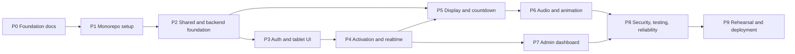

# Development Plan

Roadmap for the FIT Expo Opening Ceremony system. Read [AGENTS.md](AGENTS.md) before working on any task.

## Status legend

| Status        | Meaning                                                                               |
| ------------- | ------------------------------------------------------------------------------------- |
| `NOT STARTED` | No work done                                                                          |
| `IN PROGRESS` | Work underway, not yet verified                                                       |
| `BLOCKED`     | Waiting on a decision or external input (reason noted)                                |
| `DONE`        | Implemented **and** verified (tests, lint, typecheck and build pass where applicable) |

Rules: update a task's status in the same change that completes it. Never mark `DONE` without verification. Task IDs are stable; add new tasks with new IDs rather than renumbering.

## Phase overview

---

## Phase 0: Repository foundation and documentation

**Objectives:** establish shared understanding, architecture, contracts and agent rules before any code.

**Dependencies:** none.

| ID     | Task                                                                                           | Status                        |
| ------ | ---------------------------------------------------------------------------------------------- | ----------------------------- |
| P0-T01 | Inspect existing repository (empty repo, no commits)                                           | DONE                          |
| P0-T02 | Extract brand colours and fonts from itfac.uom.ac.lk CSS                                       | DONE                          |
| P0-T03 | Write `AGENTS.md`                                                                              | DONE                          |
| P0-T04 | Write `PLAN.md`                                                                                | DONE                          |
| P0-T05 | Write `README.md`                                                                              | DONE                          |
| P0-T06 | Write `docs/` set: overview, architecture, requirements, design system, API, security, testing | DONE                          |
| P0-T07 | Add `.gitignore` excluding env files and build output                                          | DONE                          |
| P0-T08 | Cross-check documentation consistency                                                          | DONE                          |
| P0-T09 | Confirm brand colours and logo usage with the Faculty                                          | BLOCKED (awaiting Faculty)    |
| P0-T10 | Obtain official logo files and FIT Expo event mark                                             | BLOCKED (awaiting organizers) |
| P0-T11 | Confirm guest display names and titles                                                         | BLOCKED (awaiting organizers) |
| P0-T12 | Review and approve this documentation set with the team                                        | NOT STARTED                   |

**Deliverables:** `AGENTS.md`, `PLAN.md`, `README.md`, `.gitignore`, seven `docs/` files.

**Acceptance criteria:**

- All documents exist and agree on states, transitions, roles, event names, error codes and requirement IDs.
- Unverified branding and pending decisions are explicitly marked.
- No application code or dependencies added.

---

## Phase 1: Monorepo and application setup

**Objectives:** create the workspace skeleton with working tooling for all three packages.

**Dependencies:** Phase 0.

| ID     | Task                                                                                                        | Status |
| ------ | ----------------------------------------------------------------------------------------------------------- | ------ |
| P1-T01 | Root `package.json` and `pnpm-workspace.yaml` (`apps/*`, `packages/*`); pin Node and pnpm versions          | DONE   |
| P1-T02 | Shared TypeScript base config (`strict`), per-package `tsconfig`                                            | DONE   |
| P1-T03 | ESLint and Prettier configuration shared across packages                                                    | DONE   |
| P1-T04 | Scaffold `apps/web` (Next.js App Router, TypeScript, Tailwind CSS v4)                                       | DONE   |
| P1-T05 | Scaffold `apps/server` (Express, TypeScript, dev runner); Socket.IO is installed and bootstrapped in P2-T09 | DONE   |
| P1-T06 | Scaffold `packages/shared` and consume it from both apps                                                    | DONE   |
| P1-T07 | Vitest set up in shared, server and web; Playwright set up in web                                           | DONE   |
| P1-T08 | Root scripts: `dev`, `build`, `lint`, `typecheck`, `test`                                                   | DONE   |
| P1-T09 | `.env.example` files for web and server (placeholders only), plus one env validation module per app         | DONE   |
| P1-T10 | Brand tokens and fonts (`@theme` tokens, `next/font` Outfit and Inter)                                      | DONE   |
| P1-T11 | Update `README.md` with real setup commands                                                                 | DONE   |

**Deliverables:** buildable, lintable empty apps; root scripts; documented setup.

**Implementation notes (Phase 1):**

- TypeScript is pinned to `~6.0.3` because typescript-eslint supports `<6.1`. TypeScript 7 is the current release.
- ESLint is pinned to `^9.39` because the plugins bundled with eslint-config-next do not support ESLint 10 yet. ESLint 9 is marked deprecated upstream, so revisit this when eslint-config-next supports ESLint 10.
- `@fit-expo/shared` is consumed as compiled output (`dist/`); see [docs/ARCHITECTURE.md](docs/ARCHITECTURE.md#1-high-level-architecture).
- Vitest was also added to `apps/web` for client-side unit tests (env parsing now; clock and countdown maths in later phases).
- `apps/web/app/page.tsx` is a neutral development landing page used by the Playwright smoke test. It is not a ceremony interface.

**Acceptance criteria:**

- `pnpm install` then root `lint`, `typecheck`, `test` and `build` succeed on a clean clone.
- Web and server start in development and the web app can import from `@fit-expo/shared`.
- No secrets committed; only `.env.example` files.

---

## Phase 2: Shared types, configuration and backend foundation

**Objectives:** implement the contracts and the authoritative state machine.

**Dependencies:** Phase 1.

| ID     | Task                                                                                                                                                                    | Status |
| ------ | ----------------------------------------------------------------------------------------------------------------------------------------------------------------------- | ------ |
| P2-T01 | Shared types: `CeremonyStatus`, `Role`, `GuestRole`, `CeremonyState`, `CountdownInfo`, `DeviceStatus`, `ActivityEntry`                                                  | DONE   |
| P2-T02 | Shared event name constants and typed event maps                                                                                                                        | DONE   |
| P2-T03 | Shared zod schemas for all REST bodies and socket payloads                                                                                                              | DONE   |
| P2-T04 | Shared error codes and defaults (`DEFAULT_COUNTDOWN_DURATION_MS = 5000`)                                                                                                | DONE   |
| P2-T05 | Extend server env validation (`apps/server/src/config/env.ts`, created in P1 for `NODE_ENV`, `HOST`, `PORT`) with the Phase 2 variables; fail fast on missing variables | DONE   |
| P2-T06 | Transition table and `CeremonyService` (synchronous decisions, `version`, `runId`, opening timer)                                                                       | DONE   |
| P2-T07 | Exhaustive unit tests for transitions, exactly-once countdown and timer cancellation                                                                                    | DONE   |
| P2-T08 | Express app: JSON limits, CORS allowlist, error middleware, `GET /api/health`                                                                                           | DONE   |
| P2-T09 | Socket.IO server bootstrap with CORS allowlist and typed events                                                                                                         | DONE   |
| P2-T10 | Structured logger with secret redaction; activity log service                                                                                                           | DONE   |

**Deliverables:** `packages/shared` contracts; server with state machine, health endpoint and logging.

**Implementation notes (Phase 2):**

- Ceremony state is **in-memory only**. A process restart returns to `WAITING` with a new `runId`. Pending countdown timers do not survive a restart. Organizers must prepare a fresh run. Future options (snapshot file or PostgreSQL) remain documented for P8-T07 if rehearsal shows a need.
- `GET /api/event/state` is available in development and test without a session. In production it returns `UNAUTHORIZED` until Phase 3 authentication.
- Socket.IO accepts connections and delivers `event:state` / `clock:sync` without auth as a transport foundation. `guest:activate` is **not** registered. Admin commands are **not** exposed over REST or sockets yet.
- `GET /api/health` also returns `status` and `environment` (safe, non-secret) in addition to `serverTime`.

**Acceptance criteria:**

- Unit tests cover 100% of transition table branches; TS-14 and TS-15 unit cases pass.
- Server refuses to start with missing required env variables.
- Contracts match [docs/API_SPECIFICATION.md](docs/API_SPECIFICATION.md).

---

## Phase 3: Guest authentication and tablet interfaces

**Objectives:** authenticate all roles and build the tablet UI shell.

**Dependencies:** Phase 2.

| ID     | Task                                                                                                     | Status |
| ------ | -------------------------------------------------------------------------------------------------------- | ------ |
| P3-T01 | In-memory guest device sessions (signed HttpOnly cookie, one active tablet per role, reconnect grace)    | DONE   |
| P3-T02 | `POST /api/guest-sessions/assign`, `GET /api/guest-sessions/current`, `POST /api/guest-sessions/release` | DONE   |
| P3-T03 | Guest session middleware for ceremony state; assignment rate limit                                       | DONE   |
| P3-T04 | Socket.IO handshake from the device-session cookie, rooms, `socket.data.role`, `guest:activate`          | DONE   |
| P3-T05 | Same-origin API and Socket.IO via Next.js rewrites (cookie stays first-party)                            | DONE   |
| P3-T06 | `/guest` role selection (not a password form). Organizer hands each tablet to the named guest            | DONE   |
| P3-T07 | Guest routes `/guest/1`, `/guest/2`, `/guest/3` with session role check                                  | DONE   |
| P3-T08 | `SlideToActivate` (pointer events, keyboard alternative) wired to `guest:activate`                       | DONE   |
| P3-T09 | Connection indicator component                                                                           | DONE   |
| P3-T10 | Integration tests for assignment, duplicate role, forged payload, unauthenticated socket                 | DONE   |

**Deliverables:** working login for all roles; tablet pages rendering state from the server (activation not yet wired).

**Acceptance criteria:**

- Each role can log in only with its own credential; wrong credentials return `UNAUTHORIZED`.
- Unauthenticated sockets are refused.
- Tablet UI meets NFR-007 touch sizes and renders correctly in portrait and landscape.

---

## Phase 4: Activation workflow and real-time synchronization

**Objectives:** wire guest activation end to end with exactly-once countdown start.

**Dependencies:** Phase 3.

| ID     | Task                                                                                       | Status                                                                                     |
| ------ | ------------------------------------------------------------------------------------------ | ------------------------------------------------------------------------------------------ |
| P4-T01 | `guest:activate` handler: permission, strict payload, call `CeremonyService.activate`, ack | DONE (wired in Phase 3 with device sessions)                                               |
| P4-T02 | Broadcast `event:state` on connect and on every change; domain events per spec             | DONE                                                                                       |
| P4-T03 | `clock:sync` handler                                                                       | DONE                                                                                       |
| P4-T04 | Client hook for ceremony snapshot with `version` and `runId` handling                      | DONE                                                                                       |
| P4-T05 | Client server-clock hook (offset estimation, re-sync on reconnect)                         | DONE                                                                                       |
| P4-T06 | Tablet states: wait, enabled, pending, activated, reconnecting                             | DONE                                                                                       |
| P4-T07 | Presence service and `device:status`                                                       | DONE (guest and display roles; admin room still receives the event)                        |
| P4-T08 | Integration tests TS-01 to TS-07, TS-13, TS-14, TS-16                                      | DONE for the guest/display paths. Admin cases in TS-06, TS-10 and TS-11 stay with Phase 7. |

**Deliverables:** three tablets can activate; server starts countdown exactly once.

**Acceptance criteria:**

- AC-FR-020/FR-021, AC-FR-012, AC-FR-014 and AC-FR-015 in [docs/REQUIREMENTS.md](docs/REQUIREMENTS.md) pass as automated tests.
- NFR-004 concurrency test passes over at least 1000 iterations.

---

## Phase 5: Main display and countdown experience

**Objectives:** build the audience-facing display for every state.

**Dependencies:** Phase 2 (contracts), Phase 4 (live events).

| ID     | Task                                                                 | Status                                                                                                                                               |
| ------ | -------------------------------------------------------------------- | ---------------------------------------------------------------------------------------------------------------------------------------------------- |
| P5-T01 | `/display` route with display authentication and fullscreen handling | DONE as `/` with a display device session (no password). Fullscreen is an operator control.                                                          |
| P5-T02 | Waiting and ready screens                                            | DONE                                                                                                                                                 |
| P5-T03 | Activation progress screen with three guest indicators               | DONE                                                                                                                                                 |
| P5-T04 | Countdown screen rendered from `opensAt` and server clock offset     | DONE                                                                                                                                                 |
| P5-T05 | Opening screen (static version; animation in Phase 6)                | DONE with a CSS reveal. Official motion treatment can still be refined.                                                                              |
| P5-T06 | Aborted screen                                                       | DONE                                                                                                                                                 |
| P5-T07 | Refresh and reconnect recovery, including mid-countdown resume       | DONE                                                                                                                                                 |
| P5-T08 | E2E tests TS-03, TS-08, TS-18                                        | DONE for the guest-to-display path. Two-browser digit timing (NFR-002) is covered by the shared countdown maths, not a second browser clock harness. |

**Deliverables:** complete display flow without audio and final animation.

**Acceptance criteria:**

- Display shows the correct screen for every state, including after refresh (FR-030, FR-031).
- Two browsers show countdown digit changes within 100 ms (NFR-002).
- Readability targets in NFR-006 met at 1920x1080.

---

## Phase 6: Audio and opening animations

**Objectives:** add ceremonial audio and the opening animation without compromising reliability.

**Dependencies:** Phase 5; audio and animation assets (PENDING).

| ID     | Task                                                                 | Status                                                                                                                  |
| ------ | -------------------------------------------------------------------- | ----------------------------------------------------------------------------------------------------------------------- |
| P6-T01 | Obtain licensed audio files: ambient, activation, countdown, opening | BLOCKED (awaiting assets)                                                                                               |
| P6-T02 | Audio manager: preload, unlock control, status, failure logging      | DONE (placeholder tones)                                                                                                |
| P6-T03 | Audio cues bound to server events and `startsAt`                     | DONE (placeholder tones)                                                                                                |
| P6-T04 | Opening animation with Motion, triggered by `event:opened`           | DONE with CSS. The `motion` package was not added.                                                                      |
| P6-T05 | Tablet activation feedback animation and optional sound              | DONE as server-driven status copy. Tablet audio was left off so the venue sound stays on the display.                   |
| P6-T06 | Abort cancels audio and animation immediately                        | DONE                                                                                                                    |
| P6-T07 | Tests TS-11 (display side) and TS-12                                 | PARTIAL. Audio failure is a unit test. Admin abort UI is Phase 7. Server abort-during-countdown is an integration test. |

**Deliverables:** full audiovisual ceremony on the display.

**Acceptance criteria:**

- With audio missing or locked, the visual sequence completes on schedule (AC-FR-062).
- All assets load with internet blocked (NFR-009, TS-23).

---

## Phase 7: Admin dashboard

**Objectives:** give organizers full control and visibility.

**Dependencies:** Phase 4.

| ID     | Task                                                                                                                         | Status                                                                                                  |
| ------ | ---------------------------------------------------------------------------------------------------------------------------- | ------------------------------------------------------------------------------------------------------- |
| P7-T01 | Admin REST endpoints: prepare, start, abort, reset                                                                           | DONE                                                                                                    |
| P7-T02 | `POST /api/event/manual-start` with phrase, password re-entry and audit                                                      | NOT IMPLEMENTED (excluded by architectural decision: trusted organizer environment, no admin passwords) |
| P7-T03 | `GET /api/event/activity` and `activity:logged` live socket emissions                                                        | DONE                                                                                                    |
| P7-T04 | `/admin` route: state panel, operational controls with confirmation modals                                                   | DONE (directly accessible without login for trusted organizers)                                         |
| P7-T05 | Guest status cards and device presence table                                                                                 | DONE                                                                                                    |
| P7-T06 | Activity log view with local timestamps and real-time updates                                                                | DONE                                                                                                    |
| P7-T07 | Guest tablet session release (`POST /api/guest-sessions/release-role`) with confirmation and prevention if already activated | DONE                                                                                                    |
| P7-T08 | Automated tests for admin lifecycle, session release, and E2E dashboard interactions                                         | DONE (REST integration in `api.integration.test.ts` and E2E in `admin.spec.ts`)                         |

**Deliverables:** operational admin dashboard at `/admin`, REST admin endpoints, real-time presence and activity stream.

**Acceptance criteria:**

- Every admin action enforces the authoritative state machine (`CeremonyService`).
- Dashboard is keyboard operable with accessible dialogs (NFR-008).
- Guest sessions can be released prior to activation; accepted activations are safeguarded.
- `/admin` is directly accessible on the trusted event console without unnecessary password layers.

---

## Phase 8: Security, testing and reliability

**Objectives:** harden the system and complete the test suite.

**Dependencies:** Phases 6 and 7.

| ID     | Task                                                         | Status                  |
| ------ | ------------------------------------------------------------ | ----------------------- |
| P8-T01 | Rate limiting on auth, admin and socket events (TS-20)       | NOT STARTED             |
| P8-T02 | Security review against [docs/SECURITY.md](docs/SECURITY.md) | NOT STARTED             |
| P8-T03 | Log redaction verification                                   | NOT STARTED             |
| P8-T04 | Full E2E ceremony test against production build              | NOT STARTED             |
| P8-T05 | Accessibility checks (TS-21)                                 | NOT STARTED             |
| P8-T06 | Backend disconnection and restart tests (TS-09)              | NOT STARTED             |
| P8-T07 | Decide on state persistence across server restart            | BLOCKED (open decision) |
| P8-T08 | 8-hour soak test (NFR-011)                                   | NOT STARTED             |

**Deliverables:** passing test suite, security review notes, resolved persistence decision.

**Acceptance criteria:**

- All TS-01 to TS-21 and TS-23 automated or documented as passing.
- No high-severity findings open from the security review.

---

## Phase 9: Venue rehearsal and deployment

**Objectives:** prove the system on real devices and the real network, then run the event.

**Dependencies:** Phase 8; venue network and hardware decisions.

| ID     | Task                                                                                                                       | Status                        |
| ------ | -------------------------------------------------------------------------------------------------------------------------- | ----------------------------- |
| P9-T01 | Venue survey and network decision (university Wi-Fi, dedicated router, or other)                                           | BLOCKED (venue access)        |
| P9-T02 | Confirm tablet models, display hardware and host machine                                                                   | BLOCKED (awaiting organizers) |
| P9-T03 | Decide credential delivery to tablets                                                                                      | NOT STARTED                   |
| P9-T04 | Production build and deployment procedure documented in README                                                             | NOT STARTED                   |
| P9-T05 | Device setup (kiosk or fullscreen, sleep disabled, audio unlocked)                                                         | NOT STARTED                   |
| P9-T06 | Rehearsals using the checklist in [docs/TESTING_STRATEGY.md](docs/TESTING_STRATEGY.md#5-venue-rehearsal-checklist) (TS-22) | NOT STARTED                   |
| P9-T07 | Operator runbook: normal flow, abort, reset, manual start, server restart                                                  | NOT STARTED                   |
| P9-T08 | Rotate credentials after rehearsal                                                                                         | NOT STARTED                   |
| P9-T09 | Event-day run                                                                                                              | NOT STARTED                   |

**Deliverables:** deployed system, runbook, rehearsal sign-off.

**Acceptance criteria:**

- Three consecutive successful full rehearsals on the venue network and real devices.
- NFR-001 latency and NFR-006 readability confirmed on site.
- Network decision recorded in [docs/ARCHITECTURE.md](docs/ARCHITECTURE.md#11-open-decisions).

---

## Open decisions

Tracked in detail in [docs/ARCHITECTURE.md](docs/ARCHITECTURE.md#11-open-decisions).

| Decision                                | Status                                                                                       | Blocks |
| --------------------------------------- | -------------------------------------------------------------------------------------------- | ------ |
| Venue network                           | PENDING                                                                                      | P9-T01 |
| State persistence across server restart | DECIDED: in-memory for the event (Phase 2). Revisit only if rehearsal proves a need (P8-T07) | P8-T07 |
| Credential delivery to tablets          | PENDING                                                                                      | P9-T03 |
| Device hardware                         | PENDING                                                                                      | P9-T02 |
| Official logo files and usage approval  | PENDING                                                                                      | P0-T10 |
| Brand colour confirmation               | PENDING                                                                                      | P0-T09 |
| Guest display names and titles          | PENDING                                                                                      | P0-T11 |
| Who may use emergency manual start      | PENDING                                                                                      | P9-T07 |
| Audio assets and licensing              | PENDING                                                                                      | P6-T01 |
