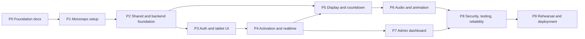

# Development Plan

Roadmap for the FIT Expo Opening Ceremony system. Read [AGENTS.md](AGENTS.md) before working on any task.

## Status legend

| Status | Meaning |
|---|---|
| `NOT STARTED` | No work done |
| `IN PROGRESS` | Work underway, not yet verified |
| `BLOCKED` | Waiting on a decision or external input (reason noted) |
| `DONE` | Implemented **and** verified (tests, lint, typecheck and build pass where applicable) |

Rules: update a task's status in the same change that completes it. Never mark `DONE` without verification. Task IDs are stable; add new tasks with new IDs rather than renumbering.

## Phase overview

---

## Phase 0: Repository foundation and documentation

**Objectives:** establish shared understanding, architecture, contracts and agent rules before any code.

**Dependencies:** none.

| ID | Task | Status |
|---|---|---|
| P0-T01 | Inspect existing repository (empty repo, no commits) | DONE |
| P0-T02 | Extract brand colours and fonts from itfac.uom.ac.lk CSS | DONE |
| P0-T03 | Write `AGENTS.md` | DONE |
| P0-T04 | Write `PLAN.md` | DONE |
| P0-T05 | Write `README.md` | DONE |
| P0-T06 | Write `docs/` set: overview, architecture, requirements, design system, API, security, testing | DONE |
| P0-T07 | Add `.gitignore` excluding env files and build output | DONE |
| P0-T08 | Cross-check documentation consistency | DONE |
| P0-T09 | Confirm brand colours and logo usage with the Faculty | BLOCKED (awaiting Faculty) |
| P0-T10 | Obtain official logo files and FIT Expo event mark | BLOCKED (awaiting organizers) |
| P0-T11 | Confirm guest display names and titles | BLOCKED (awaiting organizers) |
| P0-T12 | Review and approve this documentation set with the team | NOT STARTED |

**Deliverables:** `AGENTS.md`, `PLAN.md`, `README.md`, `.gitignore`, seven `docs/` files.

**Acceptance criteria:**

- All documents exist and agree on states, transitions, roles, event names, error codes and requirement IDs.
- Unverified branding and pending decisions are explicitly marked.
- No application code or dependencies added.

---

## Phase 1: Monorepo and application setup

**Objectives:** create the workspace skeleton with working tooling for all three packages.

**Dependencies:** Phase 0.

| ID | Task | Status |
|---|---|---|
| P1-T01 | Root `package.json` and `pnpm-workspace.yaml` (`apps/*`, `packages/*`); pin Node and pnpm versions | NOT STARTED |
| P1-T02 | Shared TypeScript base config (`strict`), per-package `tsconfig` | NOT STARTED |
| P1-T03 | ESLint and Prettier configuration shared across packages | NOT STARTED |
| P1-T04 | Scaffold `apps/web` (Next.js App Router, TypeScript, Tailwind CSS v4) | NOT STARTED |
| P1-T05 | Scaffold `apps/server` (Express + Socket.IO, TypeScript, dev runner) | NOT STARTED |
| P1-T06 | Scaffold `packages/shared` and consume it from both apps | NOT STARTED |
| P1-T07 | Vitest set up in server and shared; Playwright set up in web | NOT STARTED |
| P1-T08 | Root scripts: `dev`, `build`, `lint`, `typecheck`, `test` | NOT STARTED |
| P1-T09 | `.env.example` files for web and server (placeholders only) | NOT STARTED |
| P1-T10 | Brand tokens and fonts (`@theme` tokens, `next/font` Outfit and Inter) | NOT STARTED |
| P1-T11 | Update `README.md` with real setup commands | NOT STARTED |

**Deliverables:** buildable, lintable empty apps; root scripts; documented setup.

**Acceptance criteria:**

- `pnpm install` then root `lint`, `typecheck`, `test` and `build` succeed on a clean clone.
- Web and server start in development and the web app can import from `@fit-expo/shared`.
- No secrets committed; only `.env.example` files.

---

## Phase 2: Shared types, configuration and backend foundation

**Objectives:** implement the contracts and the authoritative state machine.

**Dependencies:** Phase 1.

| ID | Task | Status |
|---|---|---|
| P2-T01 | Shared types: `CeremonyStatus`, `Role`, `GuestRole`, `CeremonyState`, `CountdownInfo`, `DeviceStatus`, `ActivityEntry` | NOT STARTED |
| P2-T02 | Shared event name constants and typed event maps | NOT STARTED |
| P2-T03 | Shared zod schemas for all REST bodies and socket payloads | NOT STARTED |
| P2-T04 | Shared error codes and defaults (`DEFAULT_COUNTDOWN_DURATION_MS = 5000`) | NOT STARTED |
| P2-T05 | Server env parsing and validation (fail fast on missing variables) | NOT STARTED |
| P2-T06 | Transition table and `CeremonyService` (synchronous decisions, `version`, `runId`, opening timer) | NOT STARTED |
| P2-T07 | Exhaustive unit tests for transitions, exactly-once countdown and timer cancellation | NOT STARTED |
| P2-T08 | Express app: JSON limits, CORS allowlist, error middleware, `GET /api/health` | NOT STARTED |
| P2-T09 | Socket.IO server bootstrap with CORS allowlist and typed events | NOT STARTED |
| P2-T10 | Structured logger with secret redaction; activity log service | NOT STARTED |

**Deliverables:** `packages/shared` contracts; server with state machine, health endpoint and logging.

**Acceptance criteria:**

- Unit tests cover 100% of transition table branches; TS-14 and TS-15 unit cases pass.
- Server refuses to start with missing required env variables.
- Contracts match [docs/API_SPECIFICATION.md](docs/API_SPECIFICATION.md).

---

## Phase 3: Guest authentication and tablet interfaces

**Objectives:** authenticate all roles and build the tablet UI shell.

**Dependencies:** Phase 2.

| ID | Task | Status |
|---|---|---|
| P3-T01 | Auth service: constant-time credential checks, scrypt admin hash (with a documented way to generate `ADMIN_PASSWORD_HASH`), signed session tokens | NOT STARTED |
| P3-T02 | `POST /api/auth/guest`, `/api/auth/display`, `/api/auth/admin`, `GET /api/auth/session` | NOT STARTED |
| P3-T03 | REST auth middleware and permission map | NOT STARTED |
| P3-T04 | Socket.IO handshake authentication, rooms, `socket.data.role` | NOT STARTED |
| P3-T05 | Web API client and socket client (`NEXT_PUBLIC_SERVER_URL`, credentials, reconnection) | NOT STARTED |
| P3-T06 | Login form component used by guest, display and admin routes | NOT STARTED |
| P3-T07 | Guest routes `/guest/chief`, `/guest/vice-chancellor`, `/guest/dean` with role check | NOT STARTED |
| P3-T08 | `SlideToActivate` component (touch, pointer, keyboard alternative, reduced motion) | NOT STARTED |
| P3-T09 | Connection indicator component | NOT STARTED |
| P3-T10 | Integration tests for auth flows (TS-06, TS-19) | NOT STARTED |

**Deliverables:** working login for all roles; tablet pages rendering state from the server (activation not yet wired).

**Acceptance criteria:**

- Each role can log in only with its own credential; wrong credentials return `UNAUTHORIZED`.
- Unauthenticated sockets are refused.
- Tablet UI meets NFR-007 touch sizes and renders correctly in portrait and landscape.

---

## Phase 4: Activation workflow and real-time synchronization

**Objectives:** wire guest activation end to end with exactly-once countdown start.

**Dependencies:** Phase 3.

| ID | Task | Status |
|---|---|---|
| P4-T01 | `guest:activate` handler: permission, strict payload, call `CeremonyService.activate`, ack | NOT STARTED |
| P4-T02 | Broadcast `event:state` on connect and on every change; domain events per spec | NOT STARTED |
| P4-T03 | `clock:sync` handler | NOT STARTED |
| P4-T04 | Client hook for ceremony snapshot with `version` and `runId` handling | NOT STARTED |
| P4-T05 | Client server-clock hook (offset estimation, re-sync on reconnect) | NOT STARTED |
| P4-T06 | Tablet states: wait, enabled, pending, activated, reconnecting | NOT STARTED |
| P4-T07 | Presence service and `device:status` | NOT STARTED |
| P4-T08 | Integration tests TS-01 to TS-07, TS-13, TS-14, TS-16 | NOT STARTED |

**Deliverables:** three tablets can activate; server starts countdown exactly once.

**Acceptance criteria:**

- AC-FR-020/FR-021, AC-FR-012, AC-FR-014 and AC-FR-015 in [docs/REQUIREMENTS.md](docs/REQUIREMENTS.md) pass as automated tests.
- NFR-004 concurrency test passes over at least 1000 iterations.

---

## Phase 5: Main display and countdown experience

**Objectives:** build the audience-facing display for every state.

**Dependencies:** Phase 2 (contracts), Phase 4 (live events).

| ID | Task | Status |
|---|---|---|
| P5-T01 | `/display` route with display authentication and fullscreen handling | NOT STARTED |
| P5-T02 | Waiting and ready screens | NOT STARTED |
| P5-T03 | Activation progress screen with three guest indicators | NOT STARTED |
| P5-T04 | Countdown screen rendered from `opensAt` and server clock offset | NOT STARTED |
| P5-T05 | Opening screen (static version; animation in Phase 6) | NOT STARTED |
| P5-T06 | Aborted screen | NOT STARTED |
| P5-T07 | Refresh and reconnect recovery, including mid-countdown resume | NOT STARTED |
| P5-T08 | E2E tests TS-03, TS-08, TS-18 | NOT STARTED |

**Deliverables:** complete display flow without audio and final animation.

**Acceptance criteria:**

- Display shows the correct screen for every state, including after refresh (FR-030, FR-031).
- Two browsers show countdown digit changes within 100 ms (NFR-002).
- Readability targets in NFR-006 met at 1920x1080.

---

## Phase 6: Audio and opening animations

**Objectives:** add ceremonial audio and the opening animation without compromising reliability.

**Dependencies:** Phase 5; audio and animation assets (PENDING).

| ID | Task | Status |
|---|---|---|
| P6-T01 | Obtain licensed audio files: ambient, activation, countdown, opening | BLOCKED (awaiting assets) |
| P6-T02 | Audio manager: preload, unlock control, status, failure logging | NOT STARTED |
| P6-T03 | Audio cues bound to server events and `startsAt` | NOT STARTED |
| P6-T04 | Opening animation with Motion, triggered by `event:opened` | NOT STARTED |
| P6-T05 | Tablet activation feedback animation and optional sound | NOT STARTED |
| P6-T06 | Abort cancels audio and animation immediately | NOT STARTED |
| P6-T07 | Tests TS-11 (display side) and TS-12 | NOT STARTED |

**Deliverables:** full audiovisual ceremony on the display.

**Acceptance criteria:**

- With audio missing or locked, the visual sequence completes on schedule (AC-FR-062).
- All assets load with internet blocked (NFR-009, TS-23).

---

## Phase 7: Admin dashboard

**Objectives:** give organizers full control and visibility.

**Dependencies:** Phase 4.

| ID | Task | Status |
|---|---|---|
| P7-T01 | Admin REST endpoints: prepare, start, abort, reset | NOT STARTED |
| P7-T02 | `POST /api/event/manual-start` with phrase, password re-entry and audit | NOT STARTED |
| P7-T03 | `GET /api/event/activity` and `activity:logged` | NOT STARTED |
| P7-T04 | `/admin` route: state panel, controls with confirmations | NOT STARTED |
| P7-T05 | Guest status cards and device presence table | NOT STARTED |
| P7-T06 | Activity log view | NOT STARTED |
| P7-T07 | Manual start two-step dialog | NOT STARTED |
| P7-T08 | Tests TS-10, TS-11, TS-15, TS-17 | NOT STARTED |

**Deliverables:** operational admin dashboard.

**Acceptance criteria:**

- Every admin action enforces the state machine and permissions.
- AC-FR-045 passes; every manual-start attempt is audited.
- Dashboard is keyboard operable (NFR-008).

---

## Phase 8: Security, testing and reliability

**Objectives:** harden the system and complete the test suite.

**Dependencies:** Phases 6 and 7.

| ID | Task | Status |
|---|---|---|
| P8-T01 | Rate limiting on auth, admin and socket events (TS-20) | NOT STARTED |
| P8-T02 | Security review against [docs/SECURITY.md](docs/SECURITY.md) | NOT STARTED |
| P8-T03 | Log redaction verification | NOT STARTED |
| P8-T04 | Full E2E ceremony test against production build | NOT STARTED |
| P8-T05 | Accessibility checks (TS-21) | NOT STARTED |
| P8-T06 | Backend disconnection and restart tests (TS-09) | NOT STARTED |
| P8-T07 | Decide on state persistence across server restart | BLOCKED (open decision) |
| P8-T08 | 8-hour soak test (NFR-011) | NOT STARTED |

**Deliverables:** passing test suite, security review notes, resolved persistence decision.

**Acceptance criteria:**

- All TS-01 to TS-21 and TS-23 automated or documented as passing.
- No high-severity findings open from the security review.

---

## Phase 9: Venue rehearsal and deployment

**Objectives:** prove the system on real devices and the real network, then run the event.

**Dependencies:** Phase 8; venue network and hardware decisions.

| ID | Task | Status |
|---|---|---|
| P9-T01 | Venue survey and network decision (university Wi-Fi, dedicated router, or other) | BLOCKED (venue access) |
| P9-T02 | Confirm tablet models, display hardware and host machine | BLOCKED (awaiting organizers) |
| P9-T03 | Decide credential delivery to tablets | NOT STARTED |
| P9-T04 | Production build and deployment procedure documented in README | NOT STARTED |
| P9-T05 | Device setup (kiosk or fullscreen, sleep disabled, audio unlocked) | NOT STARTED |
| P9-T06 | Rehearsals using the checklist in [docs/TESTING_STRATEGY.md](docs/TESTING_STRATEGY.md#5-venue-rehearsal-checklist) (TS-22) | NOT STARTED |
| P9-T07 | Operator runbook: normal flow, abort, reset, manual start, server restart | NOT STARTED |
| P9-T08 | Rotate credentials after rehearsal | NOT STARTED |
| P9-T09 | Event-day run | NOT STARTED |

**Deliverables:** deployed system, runbook, rehearsal sign-off.

**Acceptance criteria:**

- Three consecutive successful full rehearsals on the venue network and real devices.
- NFR-001 latency and NFR-006 readability confirmed on site.
- Network decision recorded in [docs/ARCHITECTURE.md](docs/ARCHITECTURE.md#11-open-decisions).

---

## Open decisions

Tracked in detail in [docs/ARCHITECTURE.md](docs/ARCHITECTURE.md#11-open-decisions).

| Decision | Status | Blocks |
|---|---|---|
| Venue network | PENDING | P9-T01 |
| State persistence across server restart | PENDING | P8-T07 |
| Credential delivery to tablets | PENDING | P9-T03 |
| Device hardware | PENDING | P9-T02 |
| Official logo files and usage approval | PENDING | P0-T10 |
| Brand colour confirmation | PENDING | P0-T09 |
| Guest display names and titles | PENDING | P0-T11 |
| Who may use emergency manual start | PENDING | P9-T07 |
| Audio assets and licensing | PENDING | P6-T01 |
