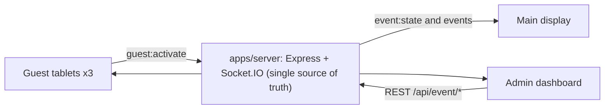

# FIT Expo Opening Ceremony

A synchronized, web-based opening ceremony system for the **FIT Expo** of the **Faculty of Information Technology, University of Moratuwa**.

Three distinguished guests (the Chief Guest, the Vice Chancellor and the Dean of IT) each slide to activate on their own tablet. When the server has accepted all three activations, the main display runs a synchronized 5-second countdown with audio, plays the opening animation, and reveals the official FIT Expo opening screen. Organizers control and monitor the ceremony from an admin dashboard.

## Current status

**Phase 0: foundation and documentation.** This repository currently contains documentation only. There is no application code, no `package.json`, and nothing to install or run yet. Setup commands will be added here in Phase 1 (see [PLAN.md](PLAN.md)).

## Interfaces

| Interface | Route |
|---|---|
| Main Display | `/display` |
| Chief Guest tablet | `/guest/chief` |
| Vice Chancellor tablet | `/guest/vice-chancellor` |
| Dean of IT tablet | `/guest/dean` |
| Admin Dashboard | `/admin` |

## Planned architecture

- `apps/web`: one Next.js (App Router) app serving all five interfaces.
- `apps/server`: one Express + Socket.IO server that owns the ceremony state machine (`WAITING`, `READY`, `COLLECTING_ACTIVATIONS`, `COUNTDOWN`, `OPENED`, `ABORTED`).
- `packages/shared`: shared TypeScript types, Socket.IO event names and zod schemas.

The backend alone decides when the countdown starts, timestamps it (`startsAt`, `opensAt`) and opens the ceremony. Clients only render. Details: [docs/ARCHITECTURE.md](docs/ARCHITECTURE.md).

## Technology stack (planned)

- TypeScript (strict) in a pnpm workspaces monorepo
- Next.js App Router, React, Tailwind CSS v4, Motion, Socket.IO client
- Node.js, Express, Socket.IO
- zod for shared validation
- Vitest, Supertest and Playwright for testing
- No database for now

## Prerequisites (planned)

- Node.js 24 or later (development machine currently uses 24.22)
- pnpm 12 or later

## Documentation

| Document | Contents |
|---|---|
| [AGENTS.md](AGENTS.md) | Rules for AI agents and contributors: read first |
| [PLAN.md](PLAN.md) | Phased roadmap and task status |
| [docs/PROJECT_OVERVIEW.md](docs/PROJECT_OVERVIEW.md) | Purpose, roles, workflow, scope |
| [docs/ARCHITECTURE.md](docs/ARCHITECTURE.md) | Architecture, state machine, synchronization, recovery, open decisions |
| [docs/REQUIREMENTS.md](docs/REQUIREMENTS.md) | Functional and non-functional requirements |
| [docs/API_SPECIFICATION.md](docs/API_SPECIFICATION.md) | Proposed REST and Socket.IO contracts and configuration |
| [docs/SECURITY.md](docs/SECURITY.md) | Authentication, authorization, secrets, rate limiting |
| [docs/DESIGN_SYSTEM.md](docs/DESIGN_SYSTEM.md) | Faculty branding, typography, UI, animation and audio principles |
| [docs/TESTING_STRATEGY.md](docs/TESTING_STRATEGY.md) | Test levels, scenarios, rehearsal checklist |

## Pending decisions

The venue network, device hardware, credential delivery, state persistence, official logo files and audio assets are not yet decided. See [PLAN.md](PLAN.md#open-decisions).

## Security note

Never commit `.env` files or credentials. Only `.env.example` files with placeholder values belong in the repository.
