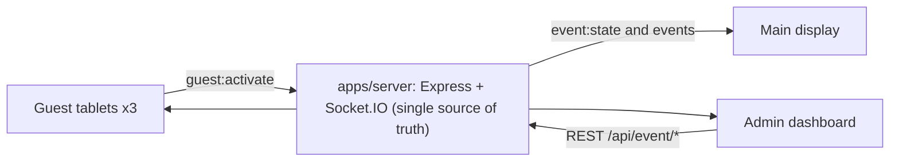

# FIT Expo Opening Ceremony

A synchronized, web-based opening ceremony system for the **FIT Expo** of the **Faculty of Information Technology, University of Moratuwa**.

Three distinguished guests (the Chief Guest, the Vice Chancellor and the Dean of IT) each slide to activate on their own tablet. When the server has accepted all three activations, the main display runs a synchronized 5-second countdown with audio, plays the opening animation, and reveals the official FIT Expo opening screen. Organizers control and monitor the ceremony from an admin dashboard.

## Current status

**Phase 1 complete: monorepo and application setup.** The workspace, the three packages, tooling, tests, environment validation and brand tokens are in place. No ceremony functionality exists yet: there are no guest, display or admin screens, no authentication, no Socket.IO and no ceremony state. Progress is tracked in [PLAN.md](PLAN.md).

## Interfaces

| Interface              | Route                    |
| ---------------------- | ------------------------ |
| Main Display           | `/display`               |
| Chief Guest tablet     | `/guest/chief`           |
| Vice Chancellor tablet | `/guest/vice-chancellor` |
| Dean of IT tablet      | `/guest/dean`            |
| Admin Dashboard        | `/admin`                 |

## Planned architecture



- `apps/web`: one Next.js (App Router) app serving all five interfaces.
- `apps/server`: one Express + Socket.IO server that owns the ceremony state machine (`WAITING`, `READY`, `COLLECTING_ACTIVATIONS`, `COUNTDOWN`, `OPENED`, `ABORTED`).
- `packages/shared`: shared TypeScript types, Socket.IO event names and zod schemas.

The backend alone decides when the countdown starts, timestamps it (`startsAt`, `opensAt`) and opens the ceremony. Clients only render. Details: [docs/ARCHITECTURE.md](docs/ARCHITECTURE.md).

## Technology stack

Installed now:

- TypeScript 6.0 (strict) in a pnpm 12 workspaces monorepo
- Next.js 16 (App Router, Turbopack), React 19, Tailwind CSS 4
- Node.js 24, Express 5
- zod 4 for environment validation (and, from Phase 2, shared payload schemas)
- Vitest 5 for unit tests, Playwright for end-to-end tests
- ESLint 9 and Prettier

Added in later phases: Socket.IO server and client, Motion, Supertest. No database for now.

## Repository layout

```
apps/
  web/        @fit-expo/web     Next.js frontend (all five interfaces, from Phase 3)
  server/     @fit-expo/server  Express backend (single source of truth, from Phase 2)
packages/
  shared/     @fit-expo/shared  Shared constants, and from Phase 2 types, events and schemas
docs/                           Architecture, requirements, API, security, design, testing
```

## Prerequisites

- Node.js 24 or later
- pnpm 12.4 or later (the exact version is pinned in `packageManager` in `package.json`)
- Internet access for `pnpm install`, the first `pnpm build` (Next.js downloads the Outfit and Inter fonts at build time and serves them locally), and the one-time Playwright browser download

## Setup

```bash
pnpm install

# Environment files (never commit the copies)
cp apps/server/.env.example apps/server/.env
cp apps/web/.env.example apps/web/.env.local
```

On Windows PowerShell use `Copy-Item` instead of `cp`. Both apps also start without these files and use the documented defaults; the server validates its variables at startup and exits with an error that names any invalid variable.

## Development

```bash
pnpm dev            # shared (watch), server on :4000 and web on :3000
pnpm dev:server     # server only
pnpm dev:web        # web only
```

`pnpm dev` builds `@fit-expo/shared` once, then runs all three packages in parallel.

## Quality checks

```bash
pnpm typecheck      # strict TypeScript in every package
pnpm lint           # ESLint in every package
pnpm test           # Vitest unit tests in every package
pnpm format         # apply Prettier
pnpm format:check   # verify Prettier formatting
pnpm check          # format check, lint, typecheck, test and build
```

End-to-end tests run against the production build:

```bash
pnpm --filter @fit-expo/web exec playwright install chromium   # once per machine
pnpm build
pnpm test:e2e
```

## Production build

```bash
pnpm build          # shared, server (tsc to apps/server/dist) and web (next build)
pnpm start:server   # node apps/server/dist/server.js
pnpm start:web      # next start
```

Deployment on the venue network is planned for Phase 9.

## Documentation

| Document                                               | Contents                                                               |
| ------------------------------------------------------ | ---------------------------------------------------------------------- |
| [AGENTS.md](AGENTS.md)                                 | Rules for AI agents and contributors: read first                       |
| [PLAN.md](PLAN.md)                                     | Phased roadmap and task status                                         |
| [docs/PROJECT_OVERVIEW.md](docs/PROJECT_OVERVIEW.md)   | Purpose, roles, workflow, scope                                        |
| [docs/ARCHITECTURE.md](docs/ARCHITECTURE.md)           | Architecture, state machine, synchronization, recovery, open decisions |
| [docs/REQUIREMENTS.md](docs/REQUIREMENTS.md)           | Functional and non-functional requirements                             |
| [docs/API_SPECIFICATION.md](docs/API_SPECIFICATION.md) | Proposed REST and Socket.IO contracts and configuration                |
| [docs/SECURITY.md](docs/SECURITY.md)                   | Authentication, authorization, secrets, rate limiting                  |
| [docs/DESIGN_SYSTEM.md](docs/DESIGN_SYSTEM.md)         | Faculty branding, typography, UI, animation and audio principles       |
| [docs/TESTING_STRATEGY.md](docs/TESTING_STRATEGY.md)   | Test levels, scenarios, rehearsal checklist                            |

## Pending decisions

The venue network, device hardware, credential delivery, state persistence, official logo files and audio assets are not yet decided. See [PLAN.md](PLAN.md#open-decisions).

## Security note

Never commit `.env` files or credentials. Only `.env.example` files with placeholder values belong in the repository.
