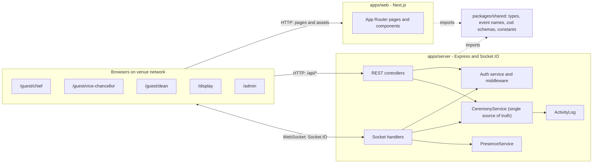
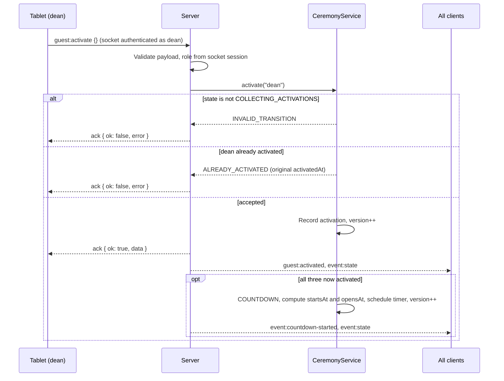
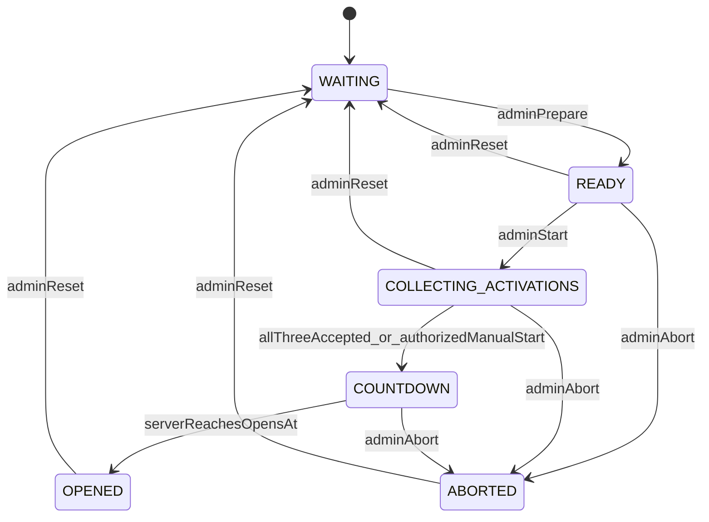
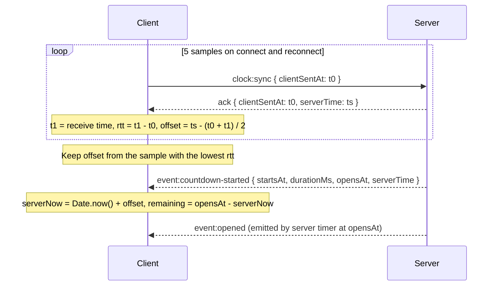
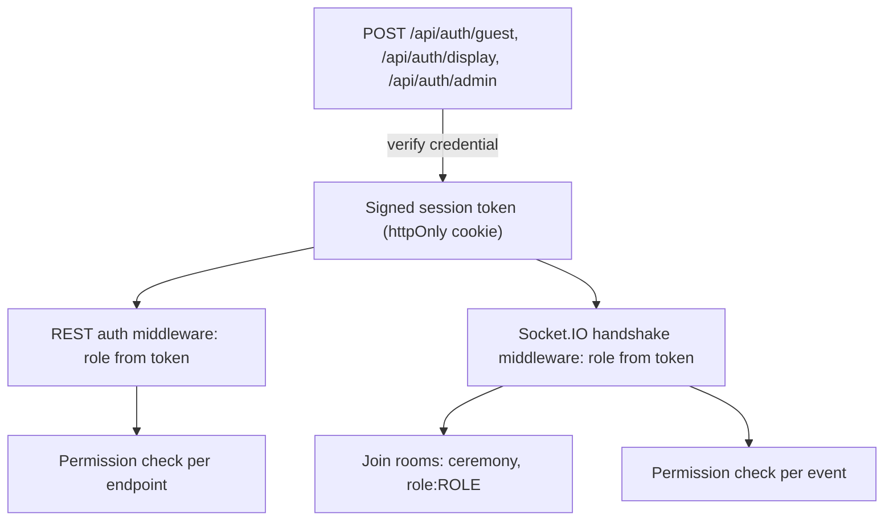

# Architecture

> Status: Proposed architecture, not yet implemented. Changes to this document require updating [AGENTS.md](../AGENTS.md), [API_SPECIFICATION.md](API_SPECIFICATION.md) and [REQUIREMENTS.md](REQUIREMENTS.md) where affected.

## 1. High-level architecture

The system is a **TypeScript pnpm monorepo** with one Next.js frontend, one Express + Socket.IO backend, and one shared package for contracts.



Workspace packages (proposed names):

| Package | Path | Purpose |
|---|---|---|
| `@fit-expo/web` | `apps/web` | Next.js App Router UI for all five interfaces |
| `@fit-expo/server` | `apps/server` | Express REST API, Socket.IO server, ceremony state |
| `@fit-expo/shared` | `packages/shared` | Types, constants, event names, zod schemas shared by both |

Deployment model: **one server process** serves the whole venue. The ceremony state lives in that process's memory. Horizontal scaling is explicitly out of scope, which is what makes the single-threaded concurrency guarantee in section 6 valid.

## 2. Responsibilities

### Backend (`apps/server`): authoritative

- Holds the only copy of ceremony state (`CeremonyService`).
- Authenticates roles and issues session tokens.
- Validates every request against shared zod schemas.
- Enforces the state machine and rejects invalid transitions.
- Records activations; rejects duplicates.
- Decides when the countdown starts (exactly once) and computes `startsAt` and `opensAt`.
- Owns the timer that moves `COUNTDOWN` to `OPENED`.
- Broadcasts state snapshots and domain events.
- Tracks device presence and an activity log.

### Frontend (`apps/web`): presentation only

- Renders the state received from the server.
- Sends user intents (`guest:activate`, admin commands) and shows the server's response.
- Estimates the server clock offset and renders the countdown from server timestamps.
- Plays audio and animations in response to server events.
- Never decides that a transition happens, never infers activation success before the server acknowledges, and never starts the opening on its own.

### Shared (`packages/shared`)

- `CeremonyStatus`, `Role`, `GuestRole` and other types.
- Socket event name constants and typed event maps for client and server.
- zod schemas for every REST body and socket payload.
- Error code constants and default configuration values (for example `DEFAULT_COUNTDOWN_DURATION_MS = 5000`).
- No runtime dependencies on Node-only or browser-only APIs.

## 3. Proposed folder structure

```
.
├── apps/
│   ├── web/
│   │   ├── app/
│   │   │   ├── display/
│   │   │   ├── guest/{chief,vice-chancellor,dean}/
│   │   │   └── admin/
│   │   ├── components/{guest,display,admin,shared}/
│   │   ├── hooks/            # useCeremonySocket, useServerClock, useAudioCues
│   │   ├── lib/              # socket client, api client, env parsing
│   │   └── public/{audio,images,animations}/
│   └── server/
│       └── src/
│           ├── config/       # env parsing and validation
│           ├── middleware/   # auth, rate limiting, error handler
│           ├── socket/       # connection auth, handlers, rooms
│           ├── services/     # auth, presence, activity log
│           ├── controllers/  # REST controllers
│           ├── state/        # CeremonyService and state machine
│           └── server.ts
├── packages/
│   └── shared/
│       └── src/{constants,events,types,schemas}/
├── docs/
├── AGENTS.md  PLAN.md  README.md
├── package.json
└── pnpm-workspace.yaml
```

Folders are created when the first real file needs them (Phase 1 onward). Empty placeholder files are not committed.

## 4. Communication flow

- **REST (`/api/*`)** is used for authentication, initial state fetch, health checks and admin commands. Admin commands are request/response operations that need clear success or failure.
- **Socket.IO** is used for everything real-time: state broadcasts, domain events, guest activation, clock sync and presence.
- The server emits a full `event:state` snapshot on every connection and after every state change. Domain events (`guest:activated`, `event:countdown-started`, and so on) are emitted in addition, to trigger audio and animation cues. **The snapshot is always the source of truth for rendering**; domain events are cues.

### Activation sequence



## 5. Event state management

### States

| State | Meaning |
|---|---|
| `WAITING` | Initial state and state after reset. Display shows a branded waiting screen. Tablets show "please wait". |
| `READY` | Admin has prepared the event. Devices are expected to be connected and audio unlocked on the display. |
| `COLLECTING_ACTIVATIONS` | Sliders are enabled. Server accepts activations. |
| `COUNTDOWN` | All three activations accepted (or manual start). Countdown is scheduled with server timestamps. |
| `OPENED` | Server timer reached `opensAt`. Display plays the opening animation, then shows the opening screen. Terminal until reset. |
| `ABORTED` | Admin aborted. Terminal until reset. |

### Transitions



| From | To | Trigger | Actor |
|---|---|---|---|
| `WAITING` | `READY` | `POST /api/event/prepare` | admin |
| `READY` | `COLLECTING_ACTIVATIONS` | `POST /api/event/start` | admin |
| `COLLECTING_ACTIVATIONS` | `COUNTDOWN` | Third accepted `guest:activate` | server (automatic) |
| `COLLECTING_ACTIVATIONS` | `COUNTDOWN` | `POST /api/event/manual-start` | admin (with confirmation) |
| `COUNTDOWN` | `OPENED` | Server timer reaches `opensAt` | server only |
| `READY`, `COLLECTING_ACTIVATIONS`, `COUNTDOWN` | `ABORTED` | `POST /api/event/abort` | admin |
| `READY`, `COLLECTING_ACTIVATIONS`, `OPENED`, `ABORTED` | `WAITING` | `POST /api/event/reset` | admin |

Every other combination is rejected with `INVALID_TRANSITION`. Notably:

- Reset is not allowed during `COUNTDOWN`; abort first. This prevents an accidental reset from silently cancelling a live opening.
- Reset from `WAITING` is rejected (nothing to reset).
- Activations are only accepted in `COLLECTING_ACTIVATIONS`.

The transition table is implemented once, in `apps/server/src/state/`, as data (a map of allowed transitions) and is unit tested exhaustively.

### State snapshot

The snapshot type is defined in `packages/shared` (see [API_SPECIFICATION.md](API_SPECIFICATION.md#3-shared-data-types)). It includes `version`, `status`, per-guest `activations`, `countdown` (or `null`), `openedAt`, `abortedAt` and `serverTime`.

## 6. Concurrency and exactly-once guarantee

Node.js runs JavaScript on a single thread. `CeremonyService.activate(role)` MUST be **fully synchronous**: it validates the state, records the activation, checks whether all three are now present, transitions to `COUNTDOWN` and schedules the opening timer **without any `await` in between**. Because no other handler can run between those steps, nearly simultaneous activations are serialized and only the request that completes the set can trigger the countdown.

Additional safeguards:

- The transition to `COUNTDOWN` is guarded by the state check itself: once the state is `COUNTDOWN`, no path can enter it again until reset.
- The opening timer handle is stored on the service. Abort and reset clear it. The timer callback re-checks that the state is still `COUNTDOWN` and that the run is unchanged before transitioning.
- Each ceremony run has a `runId` that changes on reset, so a stale timer or a stale client command cannot affect a new run.
- Any future asynchronous side effect (for example, persistence) MUST happen after the synchronous transition, and MUST NOT be awaited before the decision is made.

## 7. Countdown synchronization



Rules:

- All countdown timestamps are **epoch milliseconds from the server clock**.
- `startsAt = acceptedAt + preparationDelayMs` (default delay `0`). `opensAt = startsAt + durationMs` (default `5000`).
- Clients render digits from `opensAt - serverNow` on each animation frame. A local timer is only a rendering loop, never a source of truth.
- Countdown audio is scheduled relative to `startsAt` using the estimated server time.
- The opening animation starts when `event:opened` arrives. On a local network this adds only a small network delay, and it guarantees that an abort just before `opensAt` cannot be overtaken by a client-side opening.
- A client that connects during `COUNTDOWN` resumes at the correct remaining time. A client that connects after `OPENED` shows the final opening screen without replaying the full animation.

## 8. Network considerations

**Status: PENDING.** The venue network has not been chosen. Candidates: existing university Wi-Fi, a dedicated local router, or another arrangement after a venue survey.

The architecture therefore:

- Reads all addresses from environment variables (`NEXT_PUBLIC_SERVER_URL` on the web app; `HOST`, `PORT`, `CORS_ORIGINS` on the server). Nothing is hardcoded.
- Uses Socket.IO automatic reconnection with backoff, and its built-in heartbeat to detect dead connections.
- Shows a connection indicator on every interface.
- Pushes full state on every reconnect, so no client depends on having seen every event.
- Exposes `GET /api/health` for operators to verify reachability from each device.
- Requires no internet access during the ceremony: all assets are local (NFR-009).

## 9. Authentication boundaries



- Every REST endpoint except `GET /api/health` and the login endpoints requires a valid session.
- Every Socket.IO connection must present a valid session at handshake; unauthenticated connections are refused.
- The role on `socket.data` comes from the verified token only. Payloads never carry identity.
- Permission matrix and token details: [SECURITY.md](SECURITY.md).

## 10. Error and recovery handling

| Situation | Behaviour |
|---|---|
| Tablet disconnects after activating | Activation remains recorded. Presence shows the tablet disconnected. On reconnect the tablet receives `event:state` and shows "activated". |
| Tablet disconnects before activating | Nothing changes. Guest re-opens the page or it reconnects automatically; slider is available if still `COLLECTING_ACTIVATIONS`. |
| Display refreshed or disconnected | Re-authenticates via cookie, reconnects, receives `event:state`, renders current state (resuming countdown if active). |
| Admin disconnected | Ceremony continues unaffected; admin reconnects and receives state, presence and recent activity. |
| Backend unreachable briefly | Clients show "reconnecting"; no client advances the ceremony. On reconnect they render the server state. The server timer continues independently. |
| Backend process restarts | In-memory state is lost and returns to `WAITING`. Whether to persist state is an open decision (section 11). Operators must be trained on this during rehearsal. |
| Audio fails | Logged; visual sequence proceeds unchanged (FR-062). |
| Invalid request | Rejected with a typed error code (see [API_SPECIFICATION.md](API_SPECIFICATION.md#2-conventions)); logged; never silently ignored. |
| Unexpected server error | Error middleware returns `INTERNAL_ERROR` without stack traces; full detail is logged server-side. |

## 11. Open decisions

| Topic | Status | Notes |
|---|---|---|
| Venue network | PENDING | University Wi-Fi vs dedicated router vs other. Decide after venue survey and rehearsal. |
| State persistence across server restart | PENDING | Options: none (current), snapshot file written after each transition, or PostgreSQL. Add only if rehearsal shows a need. |
| Credential delivery to tablets | PENDING | Typed access code, QR code, or pre-provisioned link opened by organizers before the ceremony. |
| Device hardware | PENDING | Tablet models and browsers; main display resolution and aspect ratio. |
| Hosting of the web and server processes | PENDING | Single venue laptop vs dedicated machine; must be on the chosen network. |
| Countdown preparation delay | DEFAULT 0 ms | Configurable via `PREPARATION_DELAY_MS`; not required. |
