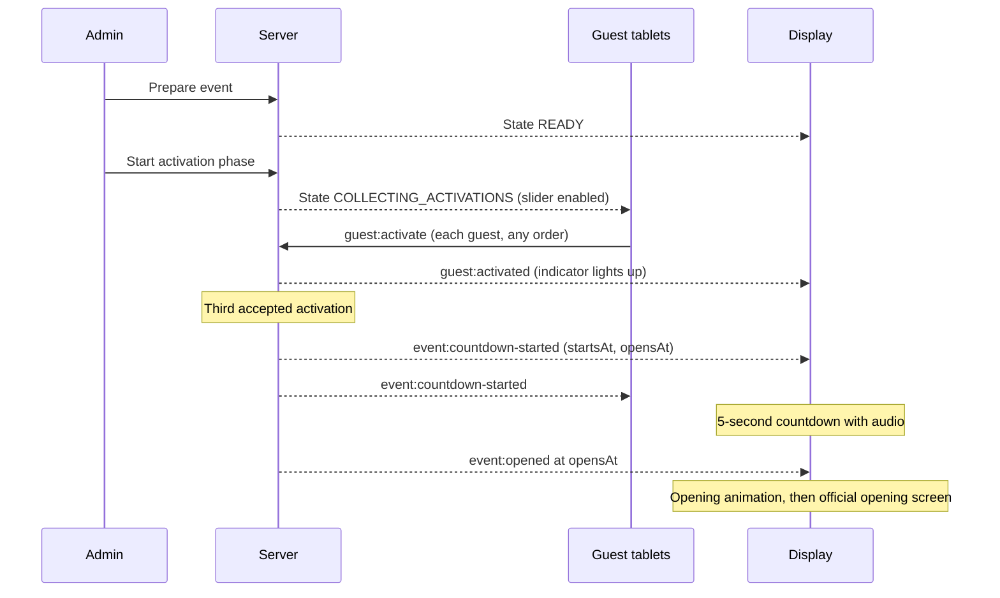

# Project Overview

> Status: Monorepo scaffold in place (Phase 1). No ceremony functionality is implemented yet. See [PLAN.md](../PLAN.md) for the roadmap.

## 1. Purpose

This project delivers a synchronized, web-based opening ceremony for the **FIT Expo** of the **Faculty of Information Technology, University of Moratuwa**.

Three distinguished guests each open the exhibition together by sliding a control on their own tablet. When the server has accepted all three activations, the main display runs a synchronized 5-second countdown with audio, plays an opening animation, and reveals the official FIT Expo opening screen.

## 2. Problem being solved

A ceremonial "joint opening" needs to feel simultaneous and reliable in front of a live audience:

- The three guests may not act at exactly the same moment. The ceremony must wait for all three, in any order, and only then proceed.
- Several devices (three tablets, one large display, one organizer laptop) must agree on what is happening and when, even if one of them drops off the network or is refreshed.
- The opening must happen **exactly once**, never prematurely, and never twice.
- Organizers need control and visibility (prepare, start, abort, reset, emergency start) without being able to trigger the opening by accident.

## 3. User roles

| Role ID           | Person                                      | Device                                                     | Interface                |
| ----------------- | ------------------------------------------- | ---------------------------------------------------------- | ------------------------ |
| `chief`           | Chief Guest                                 | Tablet                                                     | `/guest/chief`           |
| `vice-chancellor` | Vice Chancellor                             | Tablet                                                     | `/guest/vice-chancellor` |
| `dean`            | Dean, Faculty of IT                         | Tablet                                                     | `/guest/dean`            |
| `display`         | Audience, operated from the ceremony laptop | Laptop browser; a projector mirrors or extends that screen | `/`                      |
| `admin`           | Event organizer / technical operator        | Laptop or tablet                                           | `/admin`                 |

The three guest roles are collectively called **guests**. Guest display names and titles are configuration, not code, and are still to be confirmed (see [PLAN.md](../PLAN.md), open decisions).

## 4. System interfaces

1. **Main Display (`/`)**: a normal browser page on the ceremony laptop. The projector shows that same screen, either mirrored or as an extended display. The page shows a branded waiting screen, the three activation indicators, the countdown, the opening animation and the final opening screen. Animation and audio play in that browser. It does not control the projector.
2. **Guest tablets (`/guest/chief`, `/guest/vice-chancellor`, `/guest/dean`)**: each shows a single slide-to-activate control, enabled only while the server is collecting activations, plus clear confirmation once the server has accepted that guest's activation.
3. **Admin Dashboard (`/admin`)**: lets organizers prepare the event, open the activation phase, monitor guests and devices, abort, reset, view activity, and perform an authorized emergency manual start.

All five interfaces are served by one Next.js application and talk to one Express + Socket.IO server.

## 5. Core ceremony workflow

Lifecycle states: `WAITING`, `READY`, `COLLECTING_ACTIVATIONS`, `COUNTDOWN`, `OPENED`, `ABORTED`. The full state machine is in [ARCHITECTURE.md](ARCHITECTURE.md#5-event-state-management).

Business rule: the countdown begins only when `chief`, `vice-chancellor` and `dean` all have an activation accepted by the server (or an admin performs an authorized emergency manual start).

## 6. Functional scope

In scope:

- Five web interfaces listed above.
- Per-role authentication for guests, display and admin.
- Server-authoritative ceremony state machine with exactly-once countdown.
- Real-time synchronization through Socket.IO, automatic reconnection and state recovery.
- Server-timestamped countdown (default 5 seconds) rendered in sync on all clients.
- Opening animation and final opening screen on the main display.
- Ambient music, activation sound effects, countdown audio and final opening sound, all locally hosted.
- Admin controls: prepare, start activation phase, abort, reset, emergency manual start, device monitoring, activity log.
- Faculty-consistent design system across all interfaces.

Detailed, testable requirements are in [REQUIREMENTS.md](REQUIREMENTS.md).

## 7. Out of scope

- Physical door control, hardware triggers, IoT devices, relays, projector APIs, HDMI control, screen sharing, or any non-browser integration. The projector only displays the ceremony laptop's browser.
- Native mobile apps. Tablets run the web app in a browser.
- Public internet access to the ceremony, live streaming, or audience participation.
- Multi-event management, user accounts beyond the five roles, or a CMS.
- Horizontal scaling or multi-region deployment. One server instance serves the venue.
- A database, unless a later decision requires state to survive a server restart (see [ARCHITECTURE.md](ARCHITECTURE.md#11-open-decisions)).
- Assumptions about the final venue network. It is pending; see [ARCHITECTURE.md](ARCHITECTURE.md#8-network-considerations).

## 8. Related documents

- [ARCHITECTURE.md](ARCHITECTURE.md)
- [REQUIREMENTS.md](REQUIREMENTS.md)
- [API_SPECIFICATION.md](API_SPECIFICATION.md)
- [SECURITY.md](SECURITY.md)
- [DESIGN_SYSTEM.md](DESIGN_SYSTEM.md)
- [TESTING_STRATEGY.md](TESTING_STRATEGY.md)
- [AGENTS.md](../AGENTS.md)
